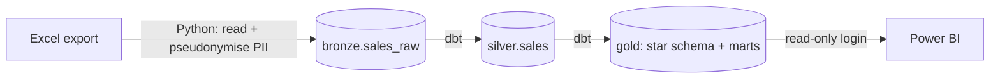

# ml-sales-medallion

End-to-end **medallion pipeline (bronze → silver → gold) on SQL Server** for a Mercado Libre sales export,
with **dbt**, **Docker Compose**, **GitHub Actions** and a Power BI-ready star schema.

> Spanish version: [README.es.md](README.es.md)
> All data in this repo is **fictional** (generated by `scripts/generate_sample_data.py`). Real exports never leave the owner's machine.

## Why this project

A real freelance case: a computer-supplies shop exports its Mercado Libre sales to Excel (two-level header, Spanish dates, 100+ status texts).
Exploratory analysis found that **two atypical delivery addresses explained ~75 % of the returns**, hiding the true behaviour of each zone.
This pipeline makes that analysis reproducible and feeds a Power BI report.

## Architecture



| Layer | What it holds | Built by |
|---|---|---|
| bronze | raw text as exported + load metadata (`_source_file`, `_file_hash`, `_loaded_at`); personal data already hashed | `ml_pipeline.ingest` |
| silver | one typed, clean row per order line; Spanish dates parsed; status categories; zones; flags | dbt |
| gold | `fact_sales`, `dim_date`, `dim_geography`, `dim_product`, `dim_status`, marts (zone summary, atypical addresses, product profitability) | dbt |

Details: [docs/architecture.md](docs/architecture.md) · [docs/decisions.md](docs/decisions.md) · [docs/powerbi.md](docs/powerbi.md)

## Privacy by design

Buyer name, document number and address are replaced by a keyed hash (HMAC-SHA256) **before** loading; billing data, tracking numbers and courier names are dropped.
The pipeline can still detect "the same address appears many times" without storing who lives there.

## Quick start

```bash
cp .env.example .env        # edit the passwords and PII_SECRET
make up                     # SQL Server + ingest + dbt seed/build/tests + grants
```

Then connect Power BI to `localhost,1433`, database `ventas_ml`, schema `gold` (see [docs/powerbi.md](docs/powerbi.md)).
To use a real export: put it in `data/raw/` (git-ignored) and run `make real FILE=data/raw/your_file.xlsx`.

## Tests

* `pytest` — unit tests (reader, pseudonymisation) and a T-SQL syntax check of every dbt model.
* `dbt build` — 4 singular tests + schema tests (unique, not null, relationships, accepted values).
* GitHub Actions runs both, the second against a SQL Server service container.

## Stack

Python · pandas · SQLAlchemy/pyodbc · SQL Server 2022 · dbt-sqlserver · Docker Compose · GitHub Actions · Power BI
