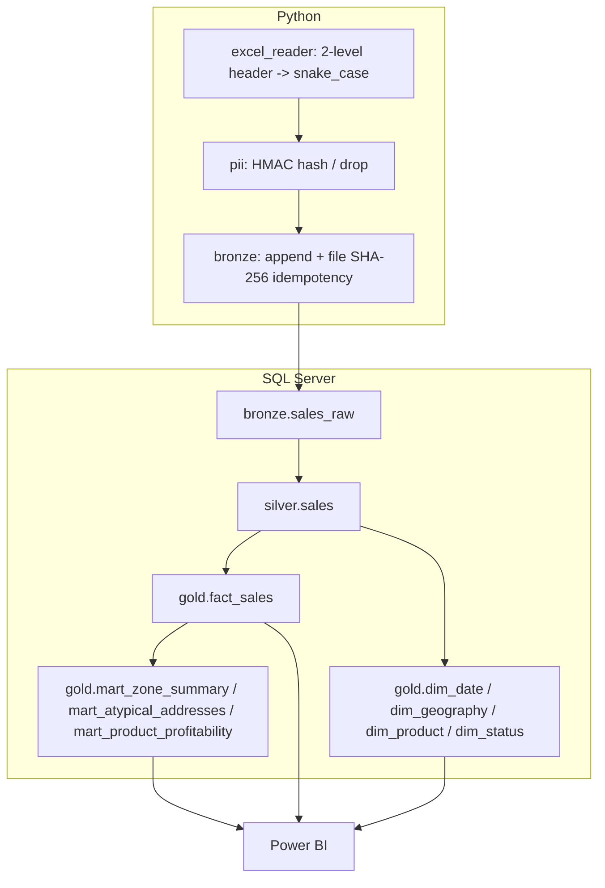

# Architecture

## Star schema

`fact_sales` (grain: order line = order_id + sku) joins to `dim_date` (date_key), `dim_geography` (geography_key), `dim_product` (sku) and `dim_status` (status_category).

## Idempotency

Ingestion stores the SHA-256 of each file; loading the same file twice is skipped (`--force` overrides).
Silver keeps the **latest** bronze version of each (order_id, sku), so a newer export updates statuses of older sales.

## Data quality

Singular dbt tests: unique key, order dates parsed, arrival not before order, returned lines never counted as net sales.
